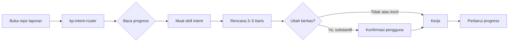

# Panduan penggunaan skill paket KP

Dokumen ini menjelaskan **cara memakai paket skill** dari [kp-agent-package](https://github.com/Fahriza253/kp-agent-package) di **repo laporan** mahasiswa. Ringkasan cepat tetap di [README.md](../../README.md); kontrak path ada di [workspace-document-contract.md](../../skills/kp/references/workspace-document-contract.md).

## Siapa membaca apa

| Pembaca                     | Workspace            | Mulai dari                                                 |
| --------------------------- | -------------------- | ---------------------------------------------------------- |
| Mahasiswa / penulis KP      | Repo laporan pribadi | Bagian 1–4                                                 |
| Agen Cursor di repo laporan | Sama                 | Bagian 2–5; muat `kp-intent-router` tiap sesi              |
| Maintainer paket            | `kp-agent-package`   | [domain.md](./domain.md), [GLOSSARY.md](../../GLOSSARY.md) |

## 1. Prasyarat

1. [Cursor](https://cursor.com) dengan fitur **Agent Skills** aktif.
2. Repo Git untuk laporan (kosong atau sudah berisi draf).
3. Koneksi jaringan untuk `npx skills add` (atau clone lokal paket).

Istilah intent dan bootstrap: [GLOSSARY.md](../../GLOSSARY.md).

## 2. Skenario lengkap: repo baru (SETUP)

### 2.1 Yang dilakukan mahasiswa (terminal)

```bash
cd /path/ke/repo-laporan-saya
git init   # bila belum

npx skills@latest add Fahriza253/kp-agent-package -a cursor
```

Pilih semua skill `kp-*` dan `academic-*` yang relevan (minimal: `kp-intent-router`, keluarga `setup-kp-*`, `kp-draft-section`, `kp-audit`, `academic-writing-core`).

### 2.2 Yang dilakukan mahasiswa (chat Cursor)

**Contoh permintaan:**

```text
Setup repo laporan KP dari nol. Ikuti setup-kp-repo dan konfirmasi sebelum menulis berkas.
```

**Perilaku agen yang diharapkan:**

| Langkah | Skill               | Perintah / hasil                                                    |
| ------- | ------------------- | ------------------------------------------------------------------- |
| 1       | `setup-kp-rules`    | `bash .agents/skills/setup-kp-rules/scripts/install-rules.sh .`     |
| 2       | `setup-kp-scaffold` | `bash .agents/skills/setup-kp-scaffold/scripts/scaffold.sh .`       |
| 3       | `setup-kp-tooling`  | `bash .agents/skills/setup-kp-tooling/scripts/install-tooling.sh .` |
| 4       | `setup-kp-repo`     | `verify-layout.sh`; laporkan MISS jika ada                          |
| 5       | Manual (instruksi)  | Pedoman, DOCX, isi kolom progress                                   |

### 2.3 Isian manual wajib setelah scaffold

1. Salin pedoman ke `resources/PEDOMAN-KP-2026.md`.
2. Salin DOCX resmi ke `laporan/`; catat path di **Naskah Word resmi** pada `docs/agents/progress-laporan.md`.
3. Isi **Judul KP**, **Submodule SIAKAD** (`dipakai` / `tidak dipakai`).
4. Opsional: `git submodule add … siakad` bila implementasi SIAKAD dipakai.
5. Perbarui tabel **Bootstrap repo** di progress menjadi `selesai` per langkah.

**Contoh permintaan lanjutan:**

```text
Pedoman dan DOCX sudah saya salin. Cek verify-layout, lalu ringkas apa yang masih [KONFIRMASI:] di progress.
```

### 2.4 Verifikasi mandiri

```bash
bash .agents/skills/setup-kp-repo/scripts/verify-layout.sh .
python3 scripts/check_project_markdown.py
```

Kedua perintah dari **akar repo laporan**.

## 3. Alur sesi standar (setiap hari)

Urutan tetap untuk konsistensi:



**Contoh pembuka sesi:**

```text
Baca docs/agents/progress-laporan.md, tentukan intent, lalu [tugas spesifik].
```

**Penutup sesi:** agen memperbarui `docs/agents/progress-laporan.md` (tanggal, intent, perubahan, tindak lanjut) dan menyebutkan berkas itu dalam satu kalimat.

## 4. Contoh per intent

Tabel ini selaras dengan [README.md](../../README.md) dan skill `kp-intent-router`.

| Intent     | Contoh permintaan (salin ke chat)                                         | Skill utama                                 | Mengubah naskah?    | Konfirmasi khusus          |
| ---------- | ------------------------------------------------------------------------- | ------------------------------------------- | ------------------- | -------------------------- |
| SETUP      | `Setup repo KP sesuai setup-kp-repo.`                                     | `setup-kp-repo`, `setup-kp-*`               | Ya (scaffold)       | Sebelum tulis berkas       |
| STATUS     | `Di mana posisi laporan? Apa bab yang masih belum?`                       | Router + `kp-00`                            | Tidak               | -                          |
| BRAINSTORM | `Bandingkan 3 pendekatan untuk rumusan masalah BAB I.`                    | `kp-ideation`                               | Tidak               | -                          |
| DRAFT      | `Buat draf subbab 1.2 Latar Belakang, jangan masukkan ke DRAFT_KP dulu.`  | `kp-draft-section`, `academic-writing-core` | Setelah setuju      | Sebelum edit draf          |
| REVISE     | `Perbaiki paragraf ke-3 BAB IV.1 sesuai catatan di revisi/.`              | `kp-draft-section` (revisi)                 | Setelah setuju      | Sitasi/data                |
| IMPROVE    | `Celah improvement: apa yang lemah di BAB IV?`                            | `kp-audit` (gap)                            | Tidak               | -                          |
| AUDIT      | `Audit menyeluruh sebelum bimbingan minggu depan.`                        | `kp-audit` (audit)                          | Tidak               | -                          |
| VALIDATE   | `Validasi format dan sitasi; jalankan check markdown.`                    | `kp-audit` (validate), `kp-20`              | Tidak               | -                          |
| LEARN      | `Pelajari lampiran pedoman ini, buat ringkasan knowledge (belum simpan).` | `kp-source-learning`                        | Tidak sampai simpan | Sebelum tulis `knowledge/` |
| HUMANIZE   | `Humanize BAB I tanpa mengubah klaim ilmiah.`                             | `academic-humanize`, `kp-10`                | Setelah setuju      | -                          |
| SYNC       | `Sinkronkan BAB I–II ke DOCX uji di GENERATED/.`                          | `kp-docx-sync`                              | Membuat DOCX baru   | Sebelum generate           |

### 4.1 Contoh DRAFT (detail)

**Permintaan:**

```text
Intent DRAFT: lengkapi outline BAB III Sarana dan Prasarana dari dokumentasi siakad.
Tampilkan rencana, peta klaim-bukti, dan jangan tulis ke DRAFT_KP sebelum saya setuju.
```

**Agen membaca:** `progress-laporan.md`, `DRAFT_KP.md`, `resources/PEDOMAN-KP-2026.md`, `siakad/` (hanya jika submodule dipakai), `docs/agents/draft-guides/` bila ada.

**Keluaran:** teks usulan, daftar `[KONFIRMASI:]` / `[PERLU SUMBER:]`, satu pertanyaan penutup.

### 4.2 Contoh VALIDATE + SYNC (berurutan)

**Sesi 1:**

```text
Validasi mekanis seluruh naskah markdown proyek kecuali yang sudah dikecualikan skrip.
```

Agen menjalankan `python scripts/check_project_markdown.py` dan memeriksa `laporan/ARCHIVE/DRAFT_KP.md` untuk em dash secara terpisah.

**Sesi 2 (setelah validasi bersih):**

```text
Sinkronkan draf ke DOCX uji. Konfirmasi path output dulu.
```

```bash
python3 -m venv .venv
.venv/bin/pip install -r scripts/requirements-docx.txt
.venv/bin/python scripts/generate_laporan_docx.py
```

Output default: `laporan/GENERATED/naskah-*.docx`.

### 4.3 Contoh LEARN

**Permintaan:**

```text
Ini contoh laporan alumni (lampiran). Ringkas pola strukturnya ke knowledge; jangan kutip teks panjang.
```

Agen menyusun draf catatan; hanya menulis `docs/agents/knowledge/<slug>.md` setelah pengguna menyetujui.

## 5. Daftar skill yang bisa dipasang

| Nama skill              | Peran singkat                                       |
| ----------------------- | --------------------------------------------------- |
| `kp-intent-router`      | Titik masuk; routing intent                         |
| `setup-kp-repo`         | Orchestrator bootstrap                              |
| `setup-kp-rules`        | Rules `.mdc`                                        |
| `setup-kp-scaffold`     | Folder + template dokumen                           |
| `setup-kp-tooling`      | Skrip `scripts/`                                    |
| `kp-install-rules`      | Alias lama rules (tidak disarankan untuk repo baru) |
| `kp-draft-section`      | Menulis/merevisi per bab                            |
| `kp-ideation`           | Brainstorm                                          |
| `kp-audit`              | Audit, gap, validate                                |
| `kp-docx-sync`          | Markdown ke DOCX                                    |
| `kp-source-learning`    | Catatan dari sumber                                 |
| `academic-writing-core` | Narasi akademik umum                                |
| `academic-humanize`     | Perapian gaya                                       |

Rules `kp-10`, `kp-20` bukan skill CLI; ada di `.cursor/rules/` setelah `setup-kp-rules`.

## 6. Aturan konfirmasi (ringkas)

Tanpa persetujuan eksplisit dalam sesi, agen **tidak** boleh:

- Menambah/mengubah sitasi atau daftar pustaka.
- Mengubah angka, hasil uji, tanggal, nama, atau klaim sistem.
- Mengubah ruang lingkup, judul, rumusan masalah, atau tujuan.
- Menulis ke `docs/agents/knowledge/`.
- Membuat atau menimpa DOCX resmi.
- Menghapus materi draf.

Daftar lengkap: `kp-00-core.mdc` setelah rules terpasang.

## 7. Troubleshooting

| Gejala                    | Kemungkinan penyebab         | Tindakan                                                       |
| ------------------------- | ---------------------------- | -------------------------------------------------------------- |
| Agen tidak kenal skill KP | Skill belum di-install       | `npx skills@latest add Fahriza253/kp-agent-package -a cursor`  |
| Rules tidak aktif         | Hanya CLI skill, tanpa rules | `setup-kp-rules`                                               |
| `verify-layout.sh` MISS   | Scaffold/tooling belum jalan | Ulangi perintah di bagian 2.1–2.2                              |
| SYNC gagal import docx    | venv kosong                  | `pip install -r scripts/requirements-docx.txt`                 |
| Agen mengutip jurnal      | Aturan sitasi                | Konfirmasi dulu; lihat `kp-20`                                 |
| Bab SIAKAD tanpa bukti    | Submodule tidak dipakai      | Set **Submodule SIAKAD** = tidak dipakai atau pasang `siakad/` |

## 8. Referensi

| Topik                       | Lokasi                                                                                      |
| --------------------------- | ------------------------------------------------------------------------------------------- |
| Instalasi singkat           | [README.md](../../README.md)                                                                |
| Kontrak path dan dependensi | [workspace-document-contract.md](../../skills/kp/references/workspace-document-contract.md) |
| Template progress (kanonik) | `skills/kp/setup-kp-scaffold/assets/templates/`                                             |
| Keputusan arsitektur        | [docs/adr/](../../docs/adr/)                                                                |
| Glosarium paket             | [GLOSSARY.md](../../GLOSSARY.md)                                                            |
